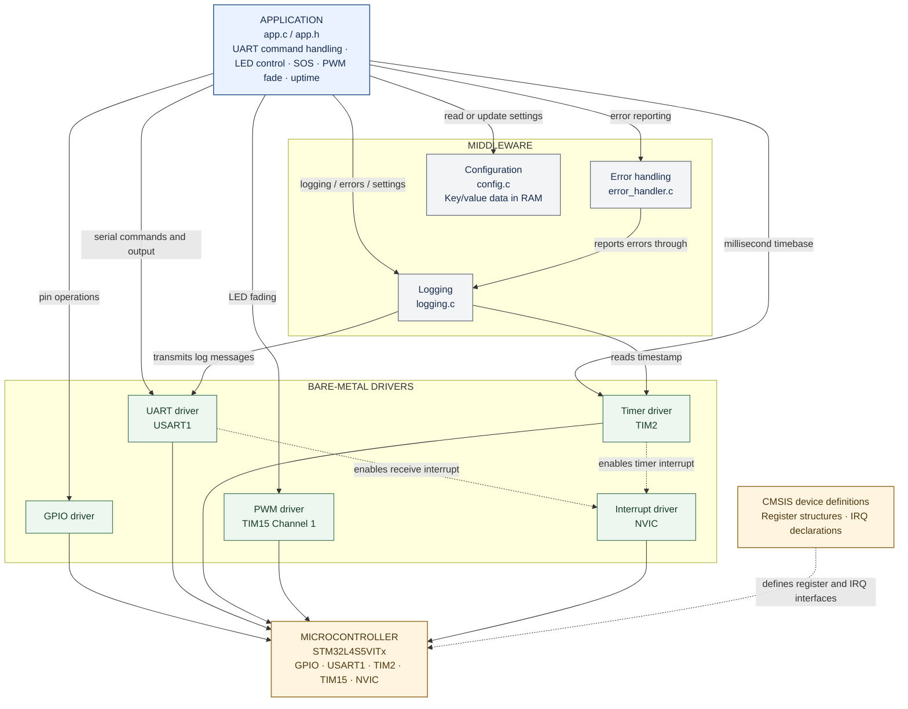

# Embedded Control Platform

A bare-metal embedded-firmware project for the **B-L4S5I-IOT01A development board** with the **STM32L4S5VITx microcontroller**.

The project demonstrates how firmware can be organised into separate layers, with reusable drivers controlling microcontroller peripherals through registers.

## Architecture

GitHub renders the Mermaid flowchart below directly in the README, so no separate image file is needed.



**How to read it:** The application coordinates the features. It calls drivers directly for GPIO, UART, timer, and PWM operations, and uses middleware for logging, error reporting, and configuration. Logging uses UART to print messages and the timer to add timestamps. Drivers operate the microcontroller peripherals. CMSIS provides the register definitions and interrupt declarations used by the code.

## Features

- GPIO pin configuration and digital input/output operations.
- UART command interface over USART1.
- TIM2-based millisecond timebase.
- TIM15 Channel 1 PWM output and LED-fading demonstration.
- Non-blocking SOS LED pattern.
- Timestamped `INFO`, `WARN`, and `ERROR` logging over UART.
- RAM-based key/value configuration.
- Error reporting with source-file and line information.
- HardFault handler that halts for debugger inspection.

## Hardware and software

| Item | Details |
|---|---|
| Development board | B-L4S5I-IOT01A |
| Microcontroller | STM32L4S5VITx |
| CPU core | Arm Cortex-M4 |
| IDE | STM32CubeIDE |
| Language | Embedded C |
| Peripheral access | Direct register access using CMSIS device definitions |
| Serial format | 115200 baud, 8 data bits, no parity, 1 stop bit (8-N-1) |
| Timer | TIM2 |
| PWM | TIM15 Channel 1, configured on PB14 in the source |

**Pin and clock note:** The current source configures USART1 on PB6/PB7 and TIM15_CH1 on PB14. Confirm these alternate-function mappings and the clock tree against the board documentation and MCU reference manual before hardware testing. The UART and PWM drivers assume a 4 MHz peripheral/timer clock.

## UART commands

Send a command followed by Enter in a serial terminal.

| Command | Action |
|---|---|
| `HELP` | Print the command list |
| `LED ON` | Turn the configured LED output on |
| `LED OFF` | Turn the configured LED output off |
| `LED TOGGLE` | Toggle the LED output |
| `FADE` | Start the PWM fading demonstration |
| `SOS` | Play the SOS LED pattern |
| `UPTIME` | Print elapsed time in seconds |

The current implementation uses PB14 for both GPIO LED control and PWM output. Switching between these modes reconfigures the pin.

## Project structure

```text
Embedded_Control_Platform/
├── Inc/       # Public headers and driver APIs
├── Src/       # Application, drivers, and middleware source
├── Startup/   # MCU startup assembly
├── *.ld       # Linker scripts
├── .project   # STM32CubeIDE project settings
├── .cproject  # Build configuration
├── .gitignore
└── README.md
```

The `Inc` and `Src` folders contain the project modules. STM32CubeIDE may also include required generated support files for startup, system initialization, and C library support. Keep files required to build the project; exclude temporary build output unless there is a specific reason to publish it.

## Software layers

### Application

`app.c` processes incoming commands and coordinates the demonstrations.

### Middleware

- **Logging (`logging.c`):** Formats messages with timestamp, severity, and source location.
- **Error handling (`error_handler.c`):** Converts error codes into readable messages and reports them through logging.
- **Configuration (`config.c`):** Stores simple key/value settings in RAM. Values are lost when the board resets.

### Drivers

- **GPIO:** Configures pins and performs digital input/output operations.
- **UART:** Configures USART1, transmits data, supports polling receive, and provides interrupt-driven receive callbacks.
- **Timer:** Uses TIM2 to maintain a millisecond counter and offers a delay helper and optional callback.
- **PWM:** Configures TIM15 Channel 1 and its duty cycle.
- **Interrupt:** Provides NVIC enable/disable wrappers.

## Build in STM32CubeIDE

1. Install **STM32CubeIDE**.
2. Open or import the existing `Embedded_Control_Platform` project.
3. Confirm the target MCU is **STM32L4S5VITx**.
4. Select **Project → Build Project**.
5. Check the build console for errors. A successful build should report zero errors.

The project has built successfully in the current development environment. Hardware-dependent behaviour should be confirmed on the physical board.

## Hardware test checklist

When the board is available:

1. Connect the board over USB and identify its serial/virtual COM port.
2. Open a serial terminal at **115200 baud, 8 data bits, no parity, 1 stop bit (115200 8-N-1)**.
3. Reset the board and confirm the startup banner appears.
4. Send `HELP` and confirm the command list appears.
5. Test `LED ON`, `LED OFF`, and `LED TOGGLE`.
6. Test `UPTIME` and confirm the reported time increases.
7. Test `FADE` and observe the PWM output/LED.
8. Test `SOS` and confirm the timed pattern completes.
9. Confirm timestamped log messages appear.
10. Record any pin, clock, or terminal configuration changes found during testing.

## Design notes

- This is a bare-metal project; it does not use an RTOS.
- The timer delay helper is a busy-wait and should not be used for long waits in latency-sensitive code.
- Timer callbacks execute inside the TIM2 interrupt handler and must be short and non-blocking.
- UART transmission and logging are polling/blocking operations. Do not call them from an interrupt handler.
- Configuration is RAM-only and resets on restart.
- `gpio_init(..., GPIO_MODE_ALTERNATE)` selects alternate-function mode; the peripheral-specific alternate-function number is configured separately.
- If the clock tree changes, update the UART/PWM clock constants and verify the baud rate and PWM frequency.

## Author

**Sushant Sharma**  
Embedded firmware portfolio project

---

This project is intended for learning and portfolio demonstration. Verify board-specific pin mappings, clock configuration, and peripheral behaviour on the target hardware before using it in a real product.
