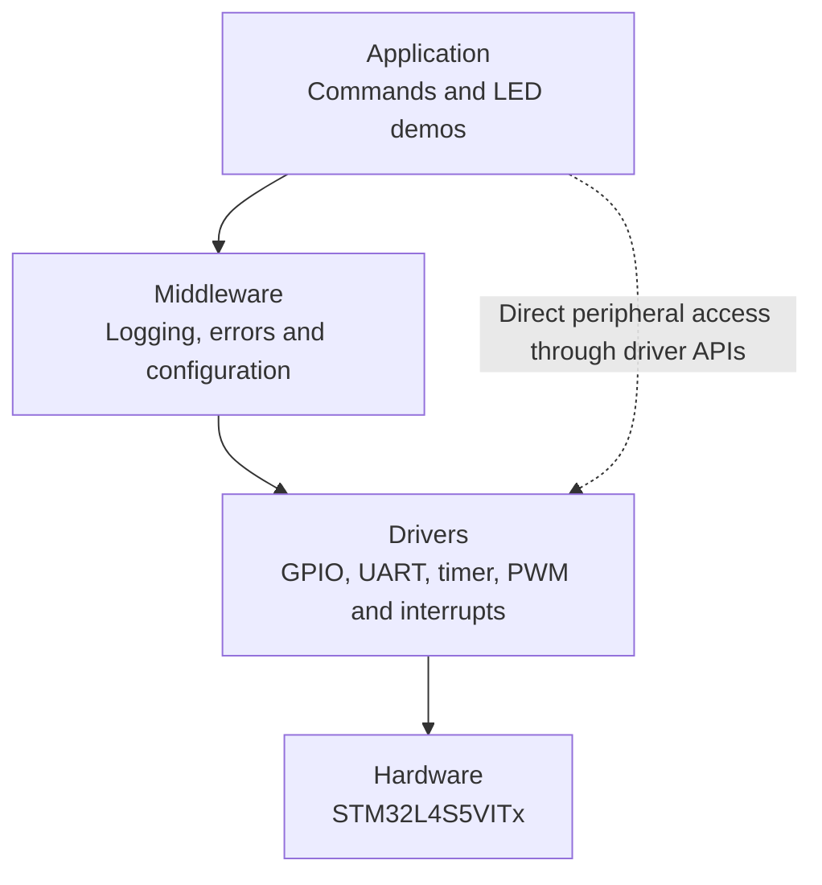

<div align="center">

# Embedded Control Platform

**A layered bare-metal firmware project for STM32**

Built for the **B-L4S5I-IOT01A** development board · **STM32L4S5VITx** microcontroller

GPIO · UART · Timers · PWM · Interrupts · Logging

</div>

---

## Overview

Embedded Control Platform is a firmware project written in Embedded C. It demonstrates how to organise low-level microcontroller software into understandable parts instead of putting all the code in one place.

The application accepts commands over a serial connection. Drivers control the microcontroller peripherals, while middleware provides shared services such as logging, error reporting, and configuration.

## Architecture



**How to read this:** The application coordinates the features. It uses middleware for shared services and also calls driver APIs directly when it needs to control a peripheral. Drivers access the microcontroller hardware.

| Layer | Responsibility | Main files |
|---|---|---|
| **Application** | Processes commands and coordinates demonstrations | `app.c`, `app.h` |
| **Middleware** | Logging, error reporting, and settings | `logging.c`, `error_handler.c`, `config.c` |
| **Drivers** | Configures and controls peripherals | `gpio_driver.c`, `uart_driver.c`, `timer_driver.c`, `pwm_driver.c`, `interrupt_driver.c` |
| **Hardware** | Executes the peripheral operations | STM32L4S5VITx |

## Features

- **GPIO control** — configure pins and read, write, or toggle digital states.
- **UART command interface** — accept text commands and return responses over USART1.
- **Millisecond timebase** — use TIM2 interrupts to maintain elapsed time.
- **PWM output** — configure TIM15 Channel 1 and adjust its duty cycle.
- **LED demonstrations** — switch the output on or off, toggle it, run a fading effect, or play an SOS pattern.
- **Timestamped logs** — send `INFO`, `WARN`, and `ERROR` messages over UART.
- **Configuration storage** — keep simple key/value settings in RAM.
- **Error handling** — turn error codes into readable messages with source-file and line details.

## Hardware and development tools

| Item | Details |
|---|---|
| Development board | B-L4S5I-IOT01A |
| Microcontroller | STM32L4S5VITx |
| CPU | Arm Cortex-M4 |
| Language | Embedded C |
| IDE | STM32CubeIDE |
| Peripheral access | Direct register access using CMSIS device definitions |
| UART format | 115200 baud · 8 data bits · no parity · 1 stop bit (8-N-1) |
| Timer | TIM2 |
| PWM | TIM15 Channel 1, configured on PB14 in the source |

**Board-specific note:** The current source configures USART1 on PB6/PB7 and TIM15 Channel 1 on PB14. Confirm the alternate-function mappings and clock configuration against the board documentation and MCU reference manual during hardware validation. The UART and PWM drivers currently assume a 4 MHz peripheral/timer clock.

## UART command reference

Connect to the board using a serial terminal, type a command, and press Enter.

| Command | What it does |
|---|---|
| `HELP` | Lists the available commands |
| `LED ON` | Sets the LED output high |
| `LED OFF` | Sets the LED output low |
| `LED TOGGLE` | Changes the current output state |
| `FADE` | Starts the PWM fading demonstration |
| `SOS` | Plays the timed SOS LED pattern |
| `UPTIME` | Prints elapsed time in seconds |

The current implementation uses PB14 for both GPIO LED control and PWM. Switching between these modes reconfigures that pin.

## Project structure

```text
Embedded_Control_Platform/
├── Inc/          # Header files and public driver APIs
├── Src/          # Application, driver, and middleware source files
├── Startup/      # MCU startup code
├── *.ld          # Linker scripts
├── .project      # STM32CubeIDE project settings
├── .cproject     # Build configuration
├── .gitignore
└── README.md
```

STM32CubeIDE projects can also contain generated files for startup, system initialization, and C library support. Keep the files needed to build and debug the project; exclude temporary build output unless there is a specific reason to publish it.

## Build the project

1. Install and open **STM32CubeIDE**.
2. Import or open the `Embedded_Control_Platform` project folder.
3. Confirm that the selected target is **STM32L4S5VITx**.
4. Select **Project → Build Project**.
5. Check the build console for errors.

The source has built successfully in the development environment. Confirm peripheral behaviour on the physical board before considering hardware testing complete.

## Hardware test checklist

When the board is available:

1. Connect it to the computer over USB and identify the correct serial/virtual COM port.
2. Open a serial terminal at **115200 baud, 8 data bits, no parity, 1 stop bit**.
3. Reset the board and check for the startup banner.
4. Send `HELP` and verify that the command list appears.
5. Test `LED ON`, `LED OFF`, and `LED TOGGLE`.
6. Test `UPTIME` and verify that the elapsed time increases.
7. Test `FADE` and observe the PWM output.
8. Test `SOS` and verify that the timed pattern completes.
9. Confirm that timestamped log messages appear in the terminal.
10. Record any pin or clock changes needed for the actual board setup.

## Implementation notes

- This is a **bare-metal** project; it does not use an RTOS.
- Configuration values are stored in RAM and are lost when the board resets.
- The timer delay helper is a busy-wait. Avoid using it for long waits in latency-sensitive code.
- Timer callbacks execute in the TIM2 interrupt handler and should be short and non-blocking.
- UART transmission and logging are blocking operations; do not call them from interrupt handlers.
- `gpio_init(..., GPIO_MODE_ALTERNATE)` selects alternate-function mode. The peripheral-specific driver configures the alternate-function number separately.
- If the clock tree changes, update the UART/PWM clock constants and verify the baud rate and PWM frequency.

## Author

**Sushant Sharma**  

---

<sub>Developed as an embedded-firmware learning and portfolio project. Verify board-specific pin mappings, clock configuration, and peripheral behaviour on the target hardware before using this code in a real product.</sub>
